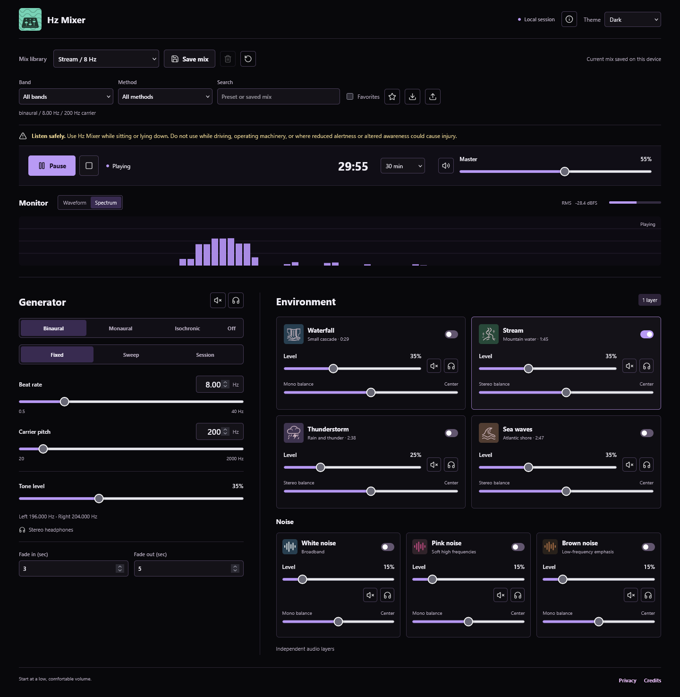

# Hz Mixer

An offline audio studio for binaural beats, monaural beats, isochronic pulses, environmental recordings and generated noise. No account, backend, telemetry or runtime CDN.



## Run the Portable App

A release ZIP contains `Hz Mixer.html` and its licence/credit files. Extract it and open the HTML in a modern desktop browser. The HTML also contains all recordings, icons, code and notices, so it works without a local server or companion files. Audio starts only after Play.

For a source checkout, use Node.js 24:

```sh
npm ci --ignore-scripts
npm run build
```

Then open the generated `Hz Mixer.html`. Node.js is needed only for development and packaging, not for listening.

## Mixer

- Binaural, monaural, isochronic and nature-only modes.
- Beat rate 0.50-40.00 Hz in 0.01 Hz steps; carrier pitch 20-2000 Hz.
- 37 presets across Delta, Theta, Alpha, Beta, Gamma and nature-only, with method filters, search and preset favorites.
- Fixed rates, linear/smooth sweeps, once/hold and ping-pong, and up to 16 hold/sweep session stages.
- Four bundled field recordings plus white, pink and brown noise, with independent level, mute, solo and stereo balance.
- Fade-in/out, crossfaded recording loops, and isochronic width, softness and depth.
- System/light/dark appearance, waveform/spectrum monitor, session progress and a digital RMS meter.
- Up to 30 named mixes, JSON mix/library backup and import, and stereo 16-bit WAV export at 44.1 or 48 kHz with progress/cancellation.

See the [mixer guide](docs/mixer-guide.md) for controls, limits, export behavior and file-storage considerations.

## Existing Beat Mixer Users

Before moving to this new filename/location, export a Library backup from the old app, then import it in Hz Mixer. File storage can be separate by browser and file location; the rebrand does not silently copy data between origins. Existing JSON formats and legacy storage keys remain compatible. The theme is a separate preference.

## Development

```sh
npm ci --ignore-scripts
npm run check
npm test
npm run dev
```

The optional source preview binds only to `127.0.0.1`, default port 5173. For another port: `npm run dev -- 5174`. Stop it with Ctrl+C.

Browser regression checks use a separate headless Firefox instance and synthetic browser storage, not a personal browser profile:

```sh
npx playwright install firefox
npm run test:browser
```

The browser runner owns a temporary loopback source server and closes it afterwards. Reports/screenshots go to ignored `output/browser/`.

## Release Preparation

```sh
npm run release:prepare
npm run release:verify
```

This builds and tests the standalone app, then produces an allowlisted ZIP, standalone HTML, manifest, checksums and release notes in ignored `dist/`. ZIP contents and hashes are verified against source, and archive metadata is fixed for reproducible builds.

The [release runbook](docs/release.md) lists manual acceptance checks and the publication boundary. CI validates and stores candidate artifacts; it does not publish releases or deploy a site. npm publishing is disabled.

## Limits and Verification

Hz Mixer is a listening and sound-design tool, not a medical device. Frequency labels describe the generated sound; they do not promise a mental state or health outcome. Binaural mode requires stereo headphones. The digital meter does not measure acoustic volume at your ears.

WAV exports are capped at two hours. Large downloads can consume substantial memory unless the browser supports direct-to-file streaming. Cancellation waits for the current rendering/decoding block. Only current settings are rendered, not the history of live edits.

Local automated checks cover source syntax, audio/state behavior, embedded assets, branding, portable packaging and release checksums. Browser checks cover the editable source over HTTP, not file-origin playback. Direct `file://` launch, native Save As and perceptual loop quality require manual acceptance; macOS/Safari/mobile listening and hosted GitHub CI have not been verified locally.

## Licensing

Original source is licensed under the [MIT License](LICENSE). The bundled recordings remain CC0 and Lucide icons retain their original notices; MIT does not replace those asset terms. See [third-party notices](THIRD_PARTY_NOTICES.md) and the credits embedded in the portable app.
