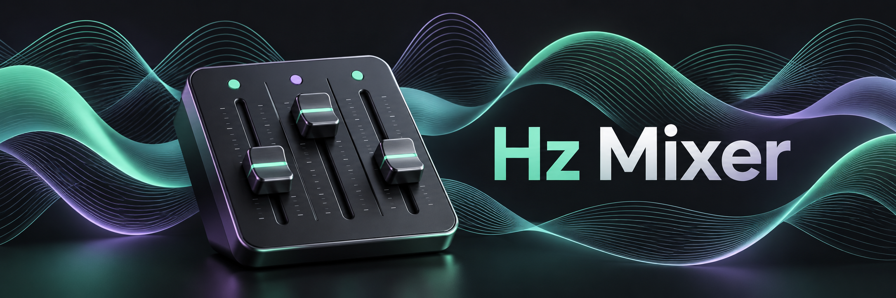

# Hz Mixer



A browser audio mixer for binaural beats, monaural beats, isochronic pulses, environmental recordings and generated noise. No account, backend, analytics or runtime CDN.

[Mixer guide](docs/mixer-guide.md) | [Offline build](#offline-build) | [Contributing](CONTRIBUTING.md)

## Features

- Binaural, monaural, isochronic and Environment only modes.
- Beat rate 0.10-120.00 Hz in 0.01 Hz steps; carrier pitch 1-5000 Hz.
- 61 presets grouped by Delta, Theta, Alpha, Beta, Gamma and Environment only, with search and favorites. Includes layered tones, AM/noise textures, dual-generator sweeps, staged sessions and singing-bowl intervals.
- Dice-button random mixes, with Simple/Advanced-aware settings, moderate channel levels and preserved master, fades and program timing.
- Permanent one-step Restore beside Reset/Dice, without changing saved mixes or favorites.
- Editable percentage boxes alongside level sliders, layered-tone/program readouts, metadata-aware search, keyboard/hover tooltips and reduced-motion-aware reset/dice feedback.
- Fixed rates, linear/smooth sweeps, once/hold or ping-pong, and an inline editor for up to 16 hold/sweep session stages with minute/second durations.
- Six environmental recordings, including Campfire and Window rain, plus white, pink and brown noise; independent level, mute, solo and balance.
- Two Tibetan bowl bells with independent repeat intervals, level, mute, solo and balance; included in saved mixes and audio exports.
- Simple mode keeps the classic Generator and full Environment mixer beneath the Monitor. Advanced reveals extra controls in the same layout, with compact source-effects popups.
- Advanced offers three tone layers with independent/follow/sweep programs, carrier bookmarks, sine/triangle/square/sawtooth/harmonic-blend carriers and FM/PM.
- Opt-in per-source AM, independent or linked channel envelopes, auto-pan/balance, low/high/band-pass and notch filters, envelope preview and monitor AM/dry A/B.
- Per-stage changes with From/To values for layer crossfades, carrier pitch, balance, AM depth and filter cutoff; shared live/WAV/MP3 processing.
- Fade-in/out, crossfaded recording loops, and isochronic width, softness and depth.
- System, black/purple Dark, Light, Green, Blue and Matrix themes; waveform/spectrum monitor, session progress and digital RMS meter. Matrix includes pausable kanji/kana code rain with mixer vocabulary and respects reduced motion.
- Up to 30 named mixes and JSON mix/library backup with previewed import.
- Stereo WAV (16-bit PCM) and MP3 (128/192/256/320 kbps), at 44.1 or 48 kHz, with progress/cancellation and optional direct-to-file saving.


The header's info button opens a quick reference and the full guide without leaving the current mixer. The [complete mixer guide](docs/mixer-guide.md) covers every control, frequency programs, saved mixes, imports, exports, themes, privacy and troubleshooting. It is embedded in both builds and also available as the website's `guide.html`. No flashing-light features are included.

## Local Data and Privacy

Mixing, rendering, encoding and JSON import run in your browser. Hz Mixer does not upload settings, imported JSON or exported audio. Current settings, saved mixes, favorites, theme, Simple/Advanced preference and Matrix rain pause state use local browser storage. Clearing site data removes them. Use a library backup to transfer mixes between browsers, the old Beat Mixer file, the website and the portable app; their storage is separate. Theme, interface and motion preferences are not part of mix backups.

The website requests static files from its host. GitHub Pages records visitor IP addresses for security. There is no service worker or promise that the website works offline after a visit. See the [privacy details](docs/privacy.md).

## Offline Build

The portable build is `Hz Mixer.html`. Open it in a modern desktop browser without a local server or companion files. It contains all recordings, icons, code, the full guide, encoder source and licence texts. It makes no automatic runtime network requests. Audio starts only after Play.

From a source checkout, Node.js 24 builds the portable file:

```sh
npm ci --ignore-scripts
npm run build:standalone
```

Node.js is required only for development and packaging, not for listening. Moving/renaming a portable file may create separate browser storage; back up your library first.

## Listening Safety

**Use Hz Mixer while sitting or lying down in a safe place. Do not use it while driving, operating machinery, or where reduced alertness or altered awareness could cause injury.**

Start at a low, comfortable volume. Use stereo headphones for binaural mode. The digital meter does not measure sound pressure at your ears.

## Development

```sh
npm ci --ignore-scripts
npm run check
npm test
npm run dev
```

`npm test` builds both distributions, then runs the Node checks. `npm run dev` previews the built website at `http://127.0.0.1:5173/`, bound only to loopback. Rebuild after source edits. See [Contributing](CONTRIBUTING.md) for browser tests, alternate ports and the source layout, and the [release runbook](docs/release.md) for packaging and deployment.

## Limits and Verification

Exports are limited to 1 second-2 hours and render current settings from the beginning, not the history of live edits. MP3 is lossy and adds codec delay/padding; WAV is the uncompressed reference. Long downloads can use substantial memory. Direct-to-file saving depends on browser support. See the [audio export guide](docs/mixer-guide.md#audio-export) for details.

Automated checks cover the built web app over loopback HTTP, audio/state behavior, guide navigation, exports, embedded assets and deterministic packaging. Direct file-origin launch, native OS Save As, perceived loop quality and macOS/Safari/mobile listening require manual acceptance on the intended devices.

## Licensing

Hz Mixer's original code and artwork use the [MIT License](LICENSE). Recordings remain CC0, Lucide utility icons retain their notices, and the separately replaceable lamejs MP3 encoder remains LGPL-3.0. These terms are not replaced by MIT. Full notices, encoder source and replacement instructions accompany both distributions. See [third-party notices](THIRD_PARTY_NOTICES.md) and [encoder information](vendor/lamejs/README.md).
